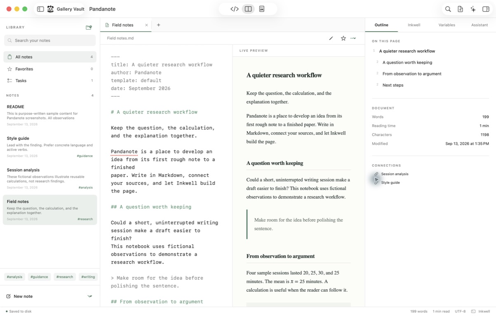

# Pandanote


A native Mac workspace for Markdown, notes, research, and Inkwell publishing.

Pandanote is a SwiftUI/AppKit application. The editor is an `NSTextView`, PDFs use
PDFKit, and the preview uses the system WebKit. There is no Electron or VS Code
runtime. A separate Node process hosts the existing Inkwell publishing engine so
documents, templates, executable blocks, and bibliography rules remain shared
with the extension.



[Screenshot gallery](docs/SCREENSHOTS.md) · [Feature inventory](docs/FEATURES.md) ·
[Web and ShareLaTeX roadmap](docs/WEB-ROADMAP.md)

## Run the app

The current source version is **0.3.0 (4)**. This repository includes the native
application, its Inkwell bridge and vendored publishing source, artwork, examples,
tests, and build tooling.

To build locally, install **Xcode 26 or newer** and **Node 20 or newer**, then run:

```sh
git clone https://github.com/goldberg-consulting/pandanote.git
cd pandanote
Scripts/build-app.sh
open dist/Pandanote.app
```

The development build uses an ad hoc signature and does not require the author's
Apple credentials. PDF publishing additionally requires Pandoc, pandoc-crossref,
and a TeX distribution. See [Build](#build) for the full requirements.

The maintainer's local Homebrew workflow installs a signed build to
`/Applications/Pandanote.app` through `goldberg-consulting/pandanote-local/pandanote`.
That tap is local, not a public Homebrew installation source. The versioned install
archive is `dist/Pandanote-0.3.0-4.zip`; generated archives are excluded from Git.
Notarization of the current 0.3.0 package is pending. Earlier notarization of
0.2.1 does not certify a later build.

Open a folder as a vault, or create a sample vault from the welcome screen.
Notes stay on disk as ordinary UTF-8 files. Existing Inkwell projects can be
opened directly.

This build includes Python variable inspection and reuse, advanced find and
replace, expanded file, folder, tab, and editor context menus, and writing teams.
Its publishing engine includes the dollar-delimiter fix: currency remains prose,
while valid inline/display math still renders. The packaged engine passed the
currency/math smoke check. The related Inkwell preview fix was merged in
[PR #98](https://github.com/goldberg-consulting/measured.one.inkwell-extension/pull/98).
See the verification notes below for tested behavior. GPT and Claude requests were verified with protocol fixtures and
injected responses; live provider calls require your configured API account.

This is **0.3, a working native foundation**, not complete MinkNote roadmap
parity. It is built for macOS 15 or newer. Apple Intelligence integration needs
macOS 26 and an available on-device model. The current build targets Apple Silicon.

## Implemented

For a dated inventory of implemented, partial, and remaining features, see
[Feature inventory](docs/FEATURES.md). The proposed
[hosted edition and ShareLaTeX compatibility roadmap](docs/WEB-ROADMAP.md) covers
portable LaTeX projects, browser editing, collaborative review, and server compilation.

- Native source editing, syntax colors, undo, find, spellchecking, macOS Writing
  Tools, source/reading/split layouts, adjustable fonts, system/light/dark appearance.
- Multiple vaults via the recent-vault switcher; nested folders; Markdown, text,
  LaTeX, and bibliography files; tabs; global text search; tags; task filtering;
  favorites, pinning, renaming, and recoverable Finder Trash.
- Autosave/manual save, minute-level history (up to 100 snapshots per note),
  coordinated writes, and explicit recovery when another app changes a note.
- Heading navigation, word count, reading time, backlinks and `[[note links]]`.
- Image/file drops into the editor, clipboard images, collision-resistant sibling
  `i/` assets, and self-contained HTML export with embedded supported local images.
- Real Inkwell setup/migration, template discovery and selection, bibliography
  keys, tool discovery, Python/R/shell/Node blocks, caching, result injection, PDF
  builds, native PDF viewing, and full build logs on disk. Configuration remains in
  Inkwell frontmatter and manifests.
- Background PDF builds with a persistent activity indicator. Compilation uses the
  source snapshot at the time Build is clicked. Autosave, vault scanning, engine
  response processing, and PDF loading run off the main thread. Keep editing or
  switch notes, then choose **View PDF** when ready; completion does not change
  the current layout or document. Failed builds preserve the last good PDF.
  The output panel shows the final 32,000 characters with **Open full log** for
  the complete output. Concurrent saves share one write and retain newer edits.
- Streaming Apple Foundation Models, Ollama, and compatible chat-completions APIs.
  Users choose current-note/filtered-note context. API keys live in Keychain.
  Highlight a passage and choose Reword, Shorten, Proofread, or a custom revision.
  Review the diff, edit the replacement, accept/reject it, or save it for later.
  Whole-document revisions are available for models with sufficient context.
  Proposals preserve the source snapshot and refuse stale or wrong-file edits;
  accepted changes are coordinated disk writes and one native undo operation.
- Guided Inkwell document settings with starter preamble creation, template-specific
  structured author/affiliation fields, typography, table styles, bibliography,
  code display, and custom LaTeX. Every field includes guidance. A complete YAML
  view and preamble diff remain available. Settings use Inkwell's resolver and
  capability checks, preserving custom metadata, comments, and document body.
- Local Git initialization, working-file diffs, selected-file commits, commit
  history, and a persistent AI review archive. Commits validate the reviewed
  snapshot, lock the index, preserve unrelated staged bytes, and use a recoverable
  index publication record. Git hooks, signed commits, branch management, merge
  resolution, and remote fetch/push are not implemented in this version. Repositories
  requiring signed commits or with a merge/rebase in progress are left to a Git client.
- Full rectangular click regions and hover outlines for note cards, folder/filter
  rows, outline entries, tabs, references, and change-list entries.
- A sketched panda with a mohawk and one red cybernetic eye, also used as the Mac application icon.

## Search launcher

Command–Space opens a floating search window while Pandanote is running, even
with the main workspace window closed. Search installed applications and note
names/paths in the current vault, use Up/Down to select, Return to open, and Escape
to dismiss. Clicking a result also opens it. Opening a note brings back the
workspace; opening search alone does not. The File menu also has **Search
Applications and Notes…**.

Application discovery reads `/Applications`, `~/Applications`,
`/System/Applications`, and the system CoreServices Applications folder directly,
including utility subfolders, without relying on Spotlight. The application list
refreshes whenever search opens. Search ignores case and accents and prioritizes
exact names and prefixes. It is not a whole-disk file or note-content search;
**Find in Vault** remains available for note contents.

If macOS reserves Command–Space for Spotlight, disable **Show Spotlight search**
in **System Settings → Keyboard → Keyboard Shortcuts → Spotlight**, then choose
**Retry Command–Space** in Pandanote’s Search settings. When available,
Option–Command–Space is also registered as a fallback. Shortcut registration
failures are shown in Search settings and the launcher. No Accessibility or Input
Monitoring permission is needed. Pandanote must be running to receive the shortcut.

## Right-click actions

Right-click a note, folder, or tab to create a note, supported text file, or folder;
rename, duplicate, move, or move the item to Finder Trash; reveal it in Finder;
or copy its absolute or vault-relative path. The menu acts on the item clicked,
even when another note is open. Empty folders appear in the library. Tabs also
support Close, Close Other Tabs, Close Tabs to the Right, and Close All Tabs.
Right-click empty library or tab-strip space to create items. The library, note,
empty-folder, and tab menus were inspected in an isolated preview with sample notes;
renaming an inactive note was confirmed to target the clicked file. The editor
Refactor/Format menus and native formatting undo were also inspected. The final
scan-responsiveness fix was verified by a regression test.

In the source editor, right-click for **Refactor → Reword, Shorten, Proofread**,
or **Extract Selection to New Note**. AI refactors use the existing proposal review
workflow and configured provider. Extraction creates a sibling note and replaces
the passage with a link; Undo restores the passage while keeping the extracted
note. The Format submenu adds Bold, Italic, and Inline Code. Duplicate Lines and
Delete Lines use native undo, and standard macOS editing actions remain available.

File operations save pending edits first and refuse to overwrite another file.
Renaming/moving folders updates open tabs, favorites, pins, and note history.
Trash asks for confirmation and remains recoverable through Finder. Rename, move,
and trash wait until active publishing finishes. Supported files are Markdown,
plain text, LaTeX, and BibTeX; these writing refactors do not provide language-server
code refactoring. Existing note links and relative attachment paths are not rewritten
when a file or folder is renamed or moved; the dialogs state that limitation.

## Find and replace

Open **Edit → Find → Find** (⌘F) or **Find and Replace** (⌥⌘F). Search the current
note, a captured selection, or the entire vault. **Find in Vault** is ⇧⌘F;
**Replace in Vault** is ⇧⌘H. Move between matches with ⌘G and ⇧⌘G. Focus mode
now uses ⌥⇧⌘F. Results show file names and line numbers; clicking a result opens
the note and selects the complete match. Matches are also highlighted in the editor.

The panel supports multiline queries, case sensitivity, Unicode-aware whole words,
and regular expressions. Regex replacements support capture groups such as `$1`
and `$2`; ordinary replacements treat those characters literally. Vault searches
can include or exclude paths with comma- or newline-separated glob patterns, such
as `Research/**/*.md` or `Drafts/**`. Search uses the open note's unsaved text.
Selection search holds the selected passage until **Use Current Selection** is
clicked; editing it asks you to capture the selection again.

Replace one match or choose **Preview Replace All…** to review before/after excerpts
and include individual files. The preview shows up to 50 excerpts per file and
states the full replacement count. Before applying, every selected file must
still match the reviewed snapshot. Originals are saved under the vault's
`.pandanote/replacements/` folder. **Undo Last Replacement** restores the most
recent batch during the session, provided those notes have no newer edits;
**Reveal Backup in Finder** exposes the saved snapshots. The open note also retains
native Undo. If a write fails partway through, the panel reports exactly how many
files changed, and the completed portion remains available to undo.

Search is bounded to 10,000 matches, 128 MB of input, and supported UTF-8 notes up
to 8 MB each. Hidden items, packages, generated/dependency directories, and symlink
files are skipped. Incomplete results are labeled, and Replace All requires a
complete result set. Regex searches have cancellation and time limits. Large vaults
can be narrowed with path filters; cloud-provider placeholder behavior remains
unverified. The panel, regex capture-group preview, per-file selection, applying
and undoing replacements, full-match navigation, editor highlights, and folder
exclusion were also verified in an isolated running app with sample notes.

## Code variables

Ordinary fenced `python` and `python3` blocks now work with **Run Code Blocks…**.
On the first explicit run, Pandanote gives each block an ID in its fence. Blocks
keep their own variables, so two blocks can both use `a` without overwriting each
other. Python captures variables automatically; `print()` remains ordinary output
and is not required to expose a value.

Open the inspector's **Variables** tab, or **Writing → Inspect Code Variables**.
The panel shows names, types, bounded value previews, and the originating block.
Filter the list, jump to its code, or choose **Insert Reference** to place a value
in Markdown prose. **How to Use…** provides copyable Markdown and Python examples.
Every variable has a stable `pv_…` reference derived from its document, block ID,
and original name. A rerun updates the value while retaining that reference;
the run ID and fingerprint separately identify the saved result.

To give a block a friendly name, set its ID explicitly:

````markdown
```{python id="analysis"}
a = 1 + 4 / 2
b = 23
c = a / b
print(c)
```

```{python depends-on="analysis"}
ratio = pandanote["analysis"]["c"]
print(ratio * 100)
```
````

The dependency executes first or supplies a verified cached result. Python gets
typed values through the `pandanote` mapping; `pandanote_vars` also supports their
hashed IDs. Each block still runs in a fresh interpreter. Scalars, bounded lists,
and dictionaries with string keys can be reused. Other objects have inspection
summaries; export simple values from them for reuse. No pickle is loaded. Markdown
references resolve to scalar text or readable JSON for collections.

Snapshots live with the existing provenance records under `.inkwell/runs/`.
Changed source, inputs, dependencies, and supported environment checks invalidate
saved values. The panel marks them stale and requires another run; failed or
unverified results are not substituted as current values. Previews read and
verify saved data without starting Python or other project interpreters. Values
are available after reopening a note, subject to the same checks. Complete Python
environment verification happens on explicit Run or Build.

Capture is bounded to 256 variables and roughly 1 MiB of reusable data per block,
with depth, collection, and string limits. The panel explicitly labels copied
content as a preview; a reference reuses the complete captured value. Python
functions, imported modules, arbitrary class instances, and unsupported large
objects are not transferred into later processes.

The runnable example is [Examples/CodeVariables.md](Examples/CodeVariables.md).
The native panel was verified with arithmetic, a dependent percentage calculation,
automatic IDs for ordinary fences, reference insertion, and a real compiled PDF
containing the resolved value. All 30 Engine tests pass, including 14 regressions
for variable capture, typed reuse, collisions, stale and tampered results, failed
reruns, exact numeric values, and previews that never launch an interpreter.

Obsolete native preview requests now terminate their own engine process, with
time and output limits. Explicit code runs and PDF builds retain their normal
lifetime. Whole-document editor updates also clear marked input before changing
text ranges, addressing a reproduced marked-text/undo crash path.

## AI mentions and writing teams

The current build includes direct OpenAI (GPT) and Anthropic (Claude) support.
Open **Settings → AI**, select a provider, enter a model ID available to your API
account, and save its key. Each provider keeps a separate key in macOS Keychain.
Apple Intelligence, Ollama, and compatible APIs remain available. GPT and Claude
use their native API formats; requests reject redirects and incomplete responses.

Highlight a passage in the source editor and choose **Ask AI**, right-click
**Ask AI about Selection**, or press **⇧⌘A**. The assistant keeps a snapshot of that
passage while you write your request. It includes the passage even when
**Include current note** is off. A revision against an outdated snapshot asks you
to capture the passage again; completed proposals retain the existing review,
accept/reject, and undo workflow.

Type **@** in the assistant or click its **@** button to search notes, agents,
skills, and rules. Choose a result to attach it, and remove its chip to exclude
it. Notes are identified by their vault-relative paths. Explicit note attachments
include the complete note up to 24,000 characters; larger notes ask you to select
a passage instead. Current-note and filtered-note context use bounded excerpts.
The editor’s Pandoc citation syntax is unchanged.

Open **Settings → Writing team** to edit the orchestrator and arrange up to eight
agents. Each agent can inherit the selected provider/model or use an override.
A team request runs the orchestrator’s plan, each enabled agent in the displayed
order, and the orchestrator’s final response. Every later stage receives earlier
contributions. Only the final response can become a proposed edit. Progress
identifies the active stage; **Stop** cancels the run.

Skills are reusable writing methods and rules are standing writing preferences.
Both contain editable prose instructions. Enabled guidance applies even with the
team off. An explicit @ mention opts a disabled agent, skill, or rule into the
current request; mentioned agents follow their saved order and activate the
orchestrator. Agent, skill, and rule mentions clear after a successful request;
note and passage attachments remain until removed. These writing agents
generate text; they do not execute scripts or tools. Team settings are saved
locally in the app’s preferences, while API keys remain in Keychain. Opening
another vault clears the assistant conversation and attachments.

Teams make multiple model calls, and included writing goes to each selected
provider or configured server. Configure every provider used by the team before
running it. Provider documentation:
[OpenAI Chat Completions](https://developers.openai.com/api/reference/resources/chat/subresources/completions/methods/create),
[Claude Messages](https://platform.claude.com/docs/en/api/http/messages/create),
[Claude streaming](https://platform.claude.com/docs/en/build-with-claude/streaming).

## Remaining product scope

The requested reference is the entire [MinkNote roadmap](https://muse23.com/apps/minknote/roadmap.html),
including its planned features. Reading view is currently read-only; visual
editing with lossless Markdown round trips remains a major milestone.

Further work includes folding and task rearrangement; richer folder organization
and drag/move behavior with attachment relocation; independent document windows;
embedded media and Mermaid preview; metadata
batch editing; dictation and OCR; encrypted biometric notes; share extensions and clipping;
publishing; location metadata and writing achievements. Companion iOS/iPad apps
and Pencil input are separate platform work. Cloud folders can host vaults, but
provider-specific sync, coordinated conflict scenarios, and offline placeholders
have not been validated.

To become a complete graphical interface for Inkwell, add bibliography entry editors, repair/install flows, per-block execution controls and
cancellation, cache inspection, Python-environment setup, structured diagnostics,
full citation/cross-reference parity in the draft view, and automated preview/PDF
parity checks across every bundled template. The existing engine supports more
than the current native controls expose.

## Build

Requires Xcode 26 or newer (the Foundation Models SDK), Node 20+, and npm. PDF
publishing uses the installed Inkwell toolchain: Pandoc, pandoc-crossref, and a TeX
distribution. R, Python, and Mermaid CLI are needed only for documents using them.

### Build and install with Homebrew

The current installation path follows TidalDrift's signed-archive workflow.
It requires Homebrew, a Developer ID Application signing identity, and an existing
notarytool Keychain profile. Full preparation uploads the signed app to Apple's
notarization service and waits for acceptance. Save your work and quit Pandanote
before installing an update.

```sh
Scripts/build-homebrew.sh
```

The script builds and signs the app, submits it to Apple, then staples and validates
the accepted notarization ticket on the app in temporary storage outside iCloud.
It verifies the signature again, creates `dist/Pandanote-0.3.0-4.zip` with the
stapled app, and generates a cask with that archive's local file URL and SHA-256
checksum. It creates the local tap `goldberg-consulting/pandanote-local`, trusts
the generated cask, then installs or reinstalls it in `/Applications`. Signature,
stapled-ticket, and Gatekeeper checks run on the archived app before installation
and on the installed app afterward.
The Homebrew tap is local; notarization submits the build to Apple without
publishing a public release.
Upgrades preserve notes, history, Keychain keys, preferences, and macOS permissions.

Preparation and installation can also run separately:

```sh
Scripts/build-homebrew.sh --prepare-only
Scripts/build-homebrew.sh --install-only
```

`--prepare-only` also uploads the signed app to Apple and waits for notarization,
then prepares the stapled versioned ZIP and cask without installing.
`--install-only` uses those prepared artifacts without rebuilding or uploading.
It also checks that the archive's app identity and version match
`Resources/Info.plist` and that the cask matches the archive checksum, file URL,
version, and current template before Homebrew touches an installed copy.
The generated cask is `.build/homebrew/Casks/pandanote.rb`, based on
`Homebrew/pandanote.rb.in`. Keep the versioned ZIP available for future reinstalls.
The version and build number come from `Resources/Info.plist`.

`PANDANOTE_SIGN_IDENTITY` defaults to
`Developer ID Application: Eli Goldberg (97UY84BV45)` for this workflow.
Set it to another available Developer ID Application identity when needed.
`PANDANOTE_NOTARY_PROFILE` defaults to the existing `notarytool-profile` Keychain
profile, matching `Scripts/package-release.sh` and TidalDrift.
`PANDANOTE_BREW` can select a Homebrew executable; the script defaults to
`/opt/homebrew/bin/brew` and otherwise searches `PATH`.

### Local development build

```sh
cd Engine
npm ci --ignore-scripts
npm run build
cd ..
Scripts/make-icons.sh
Scripts/build-app.sh
```

`build-app.sh` makes a local ad hoc signed build by default. Set
`PANDANOTE_SIGN_IDENTITY` to an available Developer ID Application identity for a
Developer ID build. It does not install to Applications, terminate running apps,
change system permissions, or publish a release.

An Xcode project can also be generated with `xcodegen generate`. `Package.swift`
provides the command-line build and test path. App resources are copied by the
packaging script; launch the packaged app for visual verification.

## Signing and distribution

The bundle ID is `com.goldbergconsulting.pandanote`. The project uses the existing
Goldberg Consulting Apple team, `97UY84BV45`. The Homebrew build workflow uses
Developer ID signing, hardened runtime, Apple notarization, and a stapled app
ticket. A separate release-packaging workflow can create a drag-to-Applications
DMG and submit it for notarization using an
existing Keychain profile. No Apple password, certificate private key, or App
Store Connect token is stored in this repository.

```sh
export PANDANOTE_SIGN_IDENTITY='Developer ID Application: Eli Goldberg (97UY84BV45)'
Scripts/package-release.sh
# To submit the built DMG to Apple and staple its ticket:
Scripts/package-release.sh --notarize
```

`PANDANOTE_NOTARY_PROFILE` defaults to TidalDrift's `notarytool-profile`. This is
Developer ID distribution, not the Mac App Store. Arbitrary project scripts and
the local publishing toolchain require capabilities beyond a simple sandboxed
document app. Node/Pandoc/TeX are external prerequisites in 0.3; a verified
toolchain installer and portable helper distribution remain release work.

## Verification

```sh
swift test --disable-sandbox
node --test Engine/tests/*.test.mjs
```

All 132 Swift tests pass, including variable inspection and insertion, stale-response
rejection, partial-run identity persistence, editing during execution, cancellation
and bounds for obsolete preview processes, marked-text replacement and undo,
literal/regex and multiline search, Unicode word
boundaries, capture-group replacement, regex cancellation, path filters, editor
highlights and full-match navigation, unsaved-text and selection search, stale
preview rejection, per-file replacement selection, saved backups, batch undo,
and context-targeted file actions, empty-folder creation,
collision refusal, folder tab/bookmark/history remapping, case-only renames, extraction
links with Unicode and delimiter characters, line editing and undo, and navigation
during a pending file operation or delayed folder scan. Existing tests include native provider requests and stream completion,
mention parsing, Unicode passage snapshots, guidance persistence, ordered team
execution, model overrides, cancellation, and saved AI revisions. They also
exercise background build/edit/navigation behavior, overlapping
saves, failed-build recovery, bounded log display, duplicate creation, external-edit refusal, history,
symlink containment, Unicode outline positions, selection boundaries, stale AI
proposals, persistent review decisions, and local Git transactions (initial commits,
renames/deletions, lock refusal, concurrent edits, and preserving unrelated staging). The bridge tests exercise
safe preview, no implicit Python execution, repeatable setup preserving edits,
real code execution/cache invalidation, path containment, preamble creation,
comment/body preservation, legacy aliases, invalid values, and template locks.
`node Scripts/verify-publication.mjs` compiles Default, Rho, and RMxAA documents
with custom preambles, math, captioned tables, and uncaptioned tables using the
actual installed Pandoc/TeX toolchain.

An integration fixture in `build/SmokeVault` has rendered HTML, executed Python,
and produced `Verification.pdf` through the actual Inkwell compiler. The native
window and note-link navigation were inspected in the running app. Apple's
on-device model availability, structured passage revision, accept, reject, and native undo were verified in the app. Empty-space clicks on note cards, tabs, and inspector tabs were verified, along with the native Git initialize/commit/history flow. Cloud AI has not been validated.
The 0.2.1 packaged app was also profiled during a real Inkwell build with an
18-second inline Python delay. The editor accepted a passage revision, saved it,
and navigated to another note; the resulting PDF retained the source snapshot and
was marked stale when opened. Process waiting, vault scanning, and coordinated
saves appeared on the background queue rather than the main thread.
All template combinations, massive vault performance, cloud sync, and broader
distribution are not claimed as verified.

## Inkwell source

The engine source is pinned to commit
`e0f0a8562bb165eee38e139c1485aa078e07534a` from
[Goldberg Consulting's Inkwell](https://github.com/goldberg-consulting/measured.one.inkwell-extension).
`Vendor/Inkwell` is a clean archive of that commit; the original checkout and its
uncommitted work are untouched. Native adaptation lives in `Engine/src`. `Engine/patches/uncaptioned-tables.mjs`
applies explicit compatibility patches to the packaged Rho/RMxAA templates: tables
without captions start their tabular correctly, and RMxAA does not request an absent
abstract. The pinned vendor source stays unchanged; custom project templates retain
their own bytes.
Inkwell's original copyright and source license are retained in
`Vendor/Inkwell/LICENSE` and in the app bundle. `out/extension.js` is retained to
satisfy Inkwell's scaffold asset contract; it is never loaded by Pandanote.

The icon artwork and its generation prompt are in `Resources/PandaSketch.png`
and `Resources/PandaSketch.prompt.md`.

## Writing and publication workflow

1. Open a vault, select a note, and choose **Inkwell → Document settings** (⌥⌘,).
   Choose a template and update the preview. Use **Add starter settings to draft**
   to make the default preamble explicit, or edit individual controls.
2. The **Template fields** category contains the template's journal-specific data;
   examples are illustrative and never inserted as real authors. The **YAML** view
   exposes the entire header, including settings without dedicated controls.
3. Choose **Update preview**, inspect **Changes**, then **Apply to document**.
   Build PDF with ⇧⌘R and keep writing while it runs. Choose **View PDF** in the
   status bar when finished. A displayed PDF is marked stale when the source changes.
4. Highlight text in the source editor and open the Assistant (⌘J). Choose a quick
   revision action or describe the desired edit and press **Revise**. **Ask** remains
   available for discussion. Review green additions and red deletions before accepting.
5. Open **Writing → Changes & Git** (⌥⇧⌘G) for saved AI proposals, Git diffs, and
   commit history. Choose the working files and a commit message to save a local
   revision. Git identity applies to that commit; no global settings are changed.

The app depends on external Node/Pandoc/TeX installations. Native review protects
existing text from stale writes; model quality still varies, so AI output remains
subject to human review. Preview typography is approximate and the PDF is authoritative.
