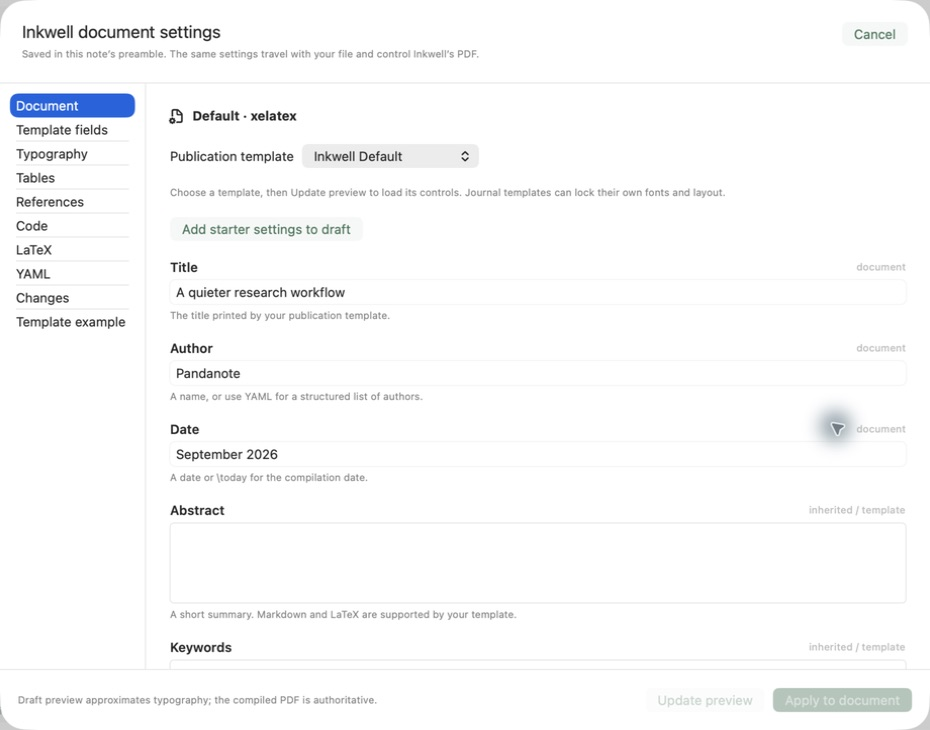
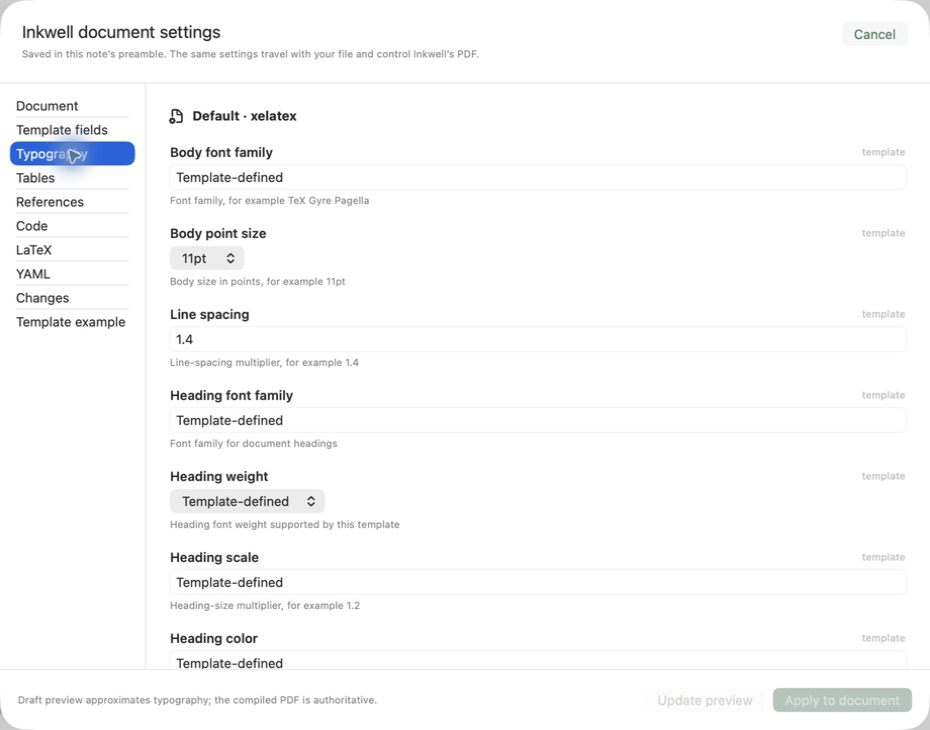
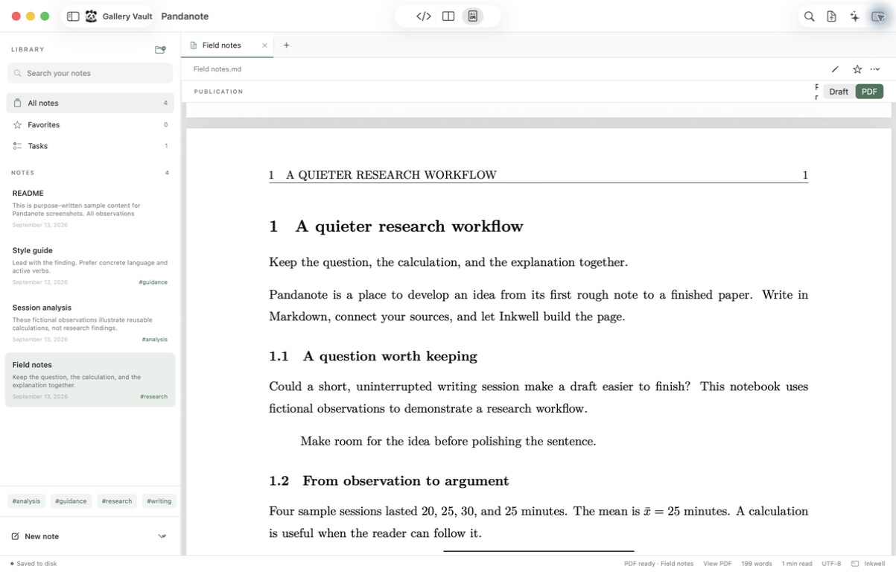
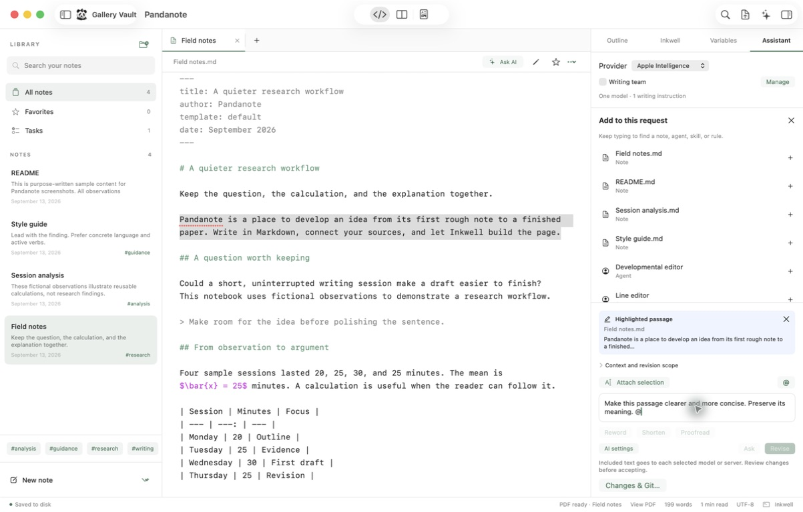

# Pandanote screenshots

Actual application captures from **13 September 2026**, using a local development
build of **0.3.0 (4)** from the audited public source
[`ead22ed`](https://github.com/goldberg-consulting/pandanote/tree/ead22ed77ec50786179c05f179c83bb0b59ee592)
on macOS 26.5.2. The screenshots are unretouched. The demonstration notebook uses
fictional observations and is available in [Examples/Gallery](../Examples/Gallery).

See the [feature inventory](FEATURES.md) for implementation status and the
[web roadmap](WEB-ROADMAP.md) for future ShareLaTeX-style compatibility.

## Native Markdown workspace

Source and live reading preview sit beside the library and outline. Notes stay in
ordinary files; tags, tasks, links, and document information are within reach.

## Guided Inkwell preamble

Document settings expose the real Inkwell configuration with field guidance,
template selection, raw YAML access, and a review step before applying changes.

## Typography controls

The typography panel shows inherited template values and explains the expected
input for each setting. The compiled PDF remains the authority for final layout.

## A real compiled publication

This PDF was built successfully using **Build PDF** in Pandanote, then opened with
**View PDF**. It is actual Inkwell output, not a mockup. The screenshot shows the
body page following the title page. The small Preview picker label is visibly
clipped; this is recorded as UI polish work in the inventory.

## Highlighted passages and AI mentions

A selected passage stays attached while composing a revision request. Typing `@`
opens note and writing-guidance choices. This capture shows request preparation;
it does not represent a generated response or a successful provider call.

## Capture and verification notes

- All five images are original JPEG bytes returned by the native screenshot tool,
  capturing the app window or active settings sheet. No crops, overlays, generated
  interface elements, or fabricated AI output were added.
- The running app used the already-tested executable from the public-source
  verification checkout. Its native and bridge source files matched the audit
  revision. It was packaged locally for capture, not presented as a notarized release.
- The demonstration vault was copied into an ignored working directory so PDF
  output, run data, and local history do not modify the public example sources.
- Opening notes, split preview, the document/typography settings, actual PDF
  compilation/viewing, passage attachment, and the mention picker were inspected
  during capture. Search, Variables, and Writing team settings are documented in
  the inventory but are not pictured in this gallery: the capture service
  disconnected before those additional views could be recorded.
- The PDF also exposed a publishing gap: `[[note links]]` still appear literally
  in this output. Draft navigation and publication link resolution are distinct.

To repeat the session, copy the [demonstration vault](../Examples/Gallery), open
it in the app, and use **Field notes.md** for editing/settings/PDF and
**Session analysis.md** for Python variable inspection. Keep UI and data authentic
when updating this gallery, and record the actual source/build used.
