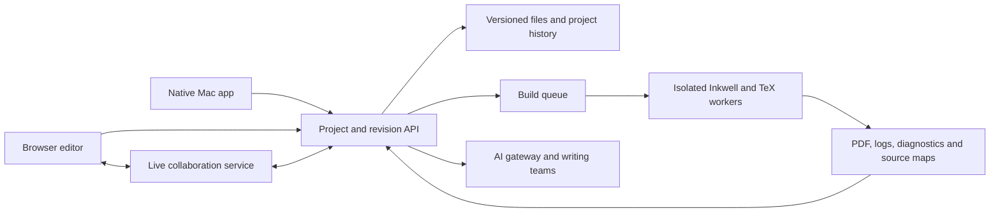

# A hosted Pandanote with ShareLaTeX compatibility

Proposed direction, **13 September 2026**. These are future requirements, not
features of the current 0.3.0 Mac app. See the [current inventory](FEATURES.md).

Keep Pandanote's native Mac experience and build a companion browser application.
Both should use the same Inkwell publishing rules, project files, AI review model,
and revision identifiers. The web application needs its own editor and service
layer; hosting the SwiftUI application or its preview HTML would not provide this.

## What compatibility means

Treat the ShareLaTeX/Overleaf goal as two commitments: **portable LaTeX projects**
and **collaborative authoring**. Inkwell Markdown remains a first-class workflow,
alongside an ordinary LaTeX project mode that preserves the author's source.
Overleaf's documented project upload, compiler selection, and collaboration
workflows establish the reference behavior:
[project upload](https://docs.overleaf.com/managing-projects-and-files/uploading-a-project),
[compiler selection](https://docs.overleaf.com/getting-started/recompiling-your-project/selecting-a-tex-live-version-and-latex-compiler),
[collaboration](https://docs.overleaf.com/collaborating/collaborating-in-overleaf).

### Portable projects

- [ ] Import/export a complete project ZIP: source, folders, images, bibliography,
  custom classes/styles, fonts, and supported build configuration. Preserve names,
  paths, Unicode, and source contents; handle archive traversal and size limits.
- [ ] A visible main-document selector and project-aware editing of `.tex`, `.bib`,
  `.sty`, `.cls`, `.bst`, and supporting text files; retain binary assets verbatim.
- [ ] Project-level pdfLaTeX, XeLaTeX, LuaLaTeX, and legacy LaTeX/DVI-to-PDF workflows.
  Current Pandanote direct `.tex` compilation is fixed to XeLaTeX; this requires
  an engine change, not just a new menu.
- [ ] Pin TeX Live, package/font versions, and build settings per project. Opening
  an old paper must not silently upgrade its compiler environment. Overleaf also
  preserves existing projects' TeX Live choices when introducing newer releases.
  [TeX Live behavior](https://docs.overleaf.com/troubleshooting-and-support/tex-live).
- [ ] Reliable multi-pass compilation, BibTeX/Biber, indexes, glossaries,
  cross-references, supported `latexmkrc` behavior, and documented shell-escape
  policy. Preserve supported local classes, fonts, and journal templates.
- [ ] Download PDF, logs, auxiliary artifacts, and submission-ready source. For
  Inkwell Markdown, export generated LaTeX plus the assets/dependencies needed to
  compile it elsewhere, alongside the original Markdown project.
- [ ] Preserve project settings in a versioned manifest. A ZIP may not carry all
  service-side settings; detect likely defaults and ask for compiler/main-file
  choices on import when they cannot be established from the project.

**Acceptance:** a fixture collection of articles, theses, multi-file books,
custom classes, BibTeX/BibLaTeX, non-Latin text, fonts, TikZ, and code-generated
figures imports, compiles, and exports without source rewriting. Exported projects
reopen and compile outside Pandanote using the recorded environment. Compare PDF
text, page count, references, and rendered layout with reviewed tolerances;
timestamps and PDF metadata make byte-for-byte equality an unsuitable sole test.
Publish a tested compatibility matrix and explicit exceptions before promising
full compatibility.

### Editor and PDF workflow

- [ ] Browser source editor with file tree, tabs, syntax highlighting, folding,
  snippets/completion, search/replace, spellcheck, equations, and citation lookup.
- [ ] Native/browser keyboard and selection workflows aligned with Pandanote's
  passage refactoring and generous row click targets.
- [ ] Configurable automatic or manual compilation, visible queue/progress, cancel,
  clean rebuild, structured errors, and last-good-output recovery.
- [ ] Side-by-side PDF, zoom/search/download, and bidirectional source/PDF
  navigation using SyncTeX. Markdown additionally needs a mapping through
  generated LaTeX back to the original note.
- [ ] Visual editing with a defined set of lossless Markdown/LaTeX round trips.
  Unsupported constructs should retain an editable source representation.
- [ ] Inkwell preamble controls, templates, bibliography editing, variables,
  dependency inspection, and environment guidance in both clients.

Source/PDF navigation is part of the reference workflow:
[Overleaf PDF viewer](https://docs.overleaf.com/navigating-in-the-editor/working-with-the-pdf-viewer).

**Acceptance:** clicking an error selects its real source range; clicking a PDF
passage reaches its source; obsolete builds never replace newer output. Edits,
search, and navigation stay responsive while a build is queued or running.

### Collaboration and change management

- [ ] Accounts, projects, invitations, ownership transfer, and owner/editor/
  reviewer/viewer permissions enforced by the server.
- [ ] Simultaneous editing with presence and reconnect recovery, using a proven
  OT or CRDT implementation. Choose and test the consistency model before adding
  shared comments or AI edits.
- [ ] Comments anchored to text, discussion threads, review mode, tracked edits,
  and accept/reject decisions attributed to their authors.
- [ ] Durable project history, named versions, diff/restore, and exportable audit
  records, including files and assets. Chat or project discussion is a separate
  collaboration feature rather than an AI conversation shared by accident.
- [ ] Git remotes and GitHub import/pull/push, explicit conflicts, and documented
  mapping between commits and collaborative history. Keep comments and tracked
  changes stable where possible, and report anchors affected by external updates.
- [ ] Reference-manager integrations and reusable bibliography libraries; template
  import/sharing; supported external storage workflows.
- [ ] Desktop/web synchronization with explicit offline behavior and conflict
  recovery, preserving ordinary local project files.

These expand the existing local Git and AI proposal workflows. Overleaf documents
real-time editing, commenting, tracking, and project sharing separately from
[Git/GitHub synchronization](https://docs.overleaf.com/integrations-and-add-ons/git-integration-and-github-synchronization).
Parity must include the user-visible workflow, not simply a Git remote.

**Acceptance:** two authors and a reviewer can edit, comment, accept a proposal,
disconnect/reconnect, and restore a version without losing work or silently
overwriting another person's changes. Revoked access must stop reads and writes.
Remote Git updates must not silently discard local edits or review discussions.

### AI that belongs to the project

- [ ] Selection and `@` context, provider/model choice, orchestrator, ordered
  agents, skills, and rules in the browser as well as on the Mac.
- [ ] Versioned project guidance and personal overrides, visible to the author
  before a request. Preserve clear control over which files/passages each stage sees.
- [ ] Server-side credential storage for hosted requests, access controls, request
  cancellation, usage limits, and per-provider failure handling. Keep credentials
  out of downloaded projects and compilation workers.
- [ ] Revision-aware proposals anchored through concurrent edits. A stale exact
  snapshot should trigger a new review or explicit conflict, never a blind replace.
- [ ] Persistent review provenance: requester, model, applied guidance, base
  revision, proposed changes, approval, and resulting revision.

**Acceptance:** a concurrent author edit between generation and acceptance cannot
be overwritten silently; team stages use the selected guidance/model; cancellation
stops pending stages; only authorized project context reaches the chosen provider.

## Proposed architecture

This is a proposed division of responsibilities. Reuse the TypeScript Inkwell
engine, templates, schema, and provenance rules; replace the desktop-specific host
adapter for server execution. Keep the Mac editor native. Define shared protocols
and cross-client fixtures for selection ranges, Unicode, revisions, and AI edits
instead of assuming the Swift UI can be reused in a browser.

Each compilation must run against an immutable project snapshot in a separate,
ephemeral worker with CPU/memory/time/output limits, controlled dependencies, and
restricted network access. TeX and Inkwell's Python/R/Node/shell blocks execute
project code; a temporary directory or ordinary background process is not a
multi-tenant isolation boundary. Compiler workers must not have account secrets,
other projects, or control-plane credentials.

Reusing Overleaf components is an architectural option to evaluate, not an
assumption. Its Community Edition explicitly targets trusted users and lacks the
isolated compilation required for untrusted multi-user hosting. Its source is
AGPL-3.0; review component licensing and distribution obligations before adopting
code. [Official Overleaf repository](https://github.com/overleaf/overleaf).

## Delivery order

1. **Compatibility foundation.** Define the portable project manifest, build-job
   contract, root-document/engine selection, and representative fixture corpus.
   Improve native diagnostics and cancellation against this same contract.
2. **Hosted compilation prototype.** Implement isolated jobs, pinned toolchains,
   status/cancel, immutable inputs, and PDF/log/source-map retrieval. Validate
   isolation, timeout cleanup, and reproducible fixture outputs before public use.
3. **Single-author browser edition.** Accounts, project storage, ZIP import/export,
   source editor, PDF, settings, bibliography, and AI review. Demonstrate the
   import → edit → compile → export loop before calling it compatible.
4. **Shared authoring.** Live edits, anchored comments/proposals, permissions,
   tracked changes, history, and Git integration, with concurrent-edit tests.
5. **Desktop sync and production launch.** Offline conflict recovery, backups and
   tested restores, quotas, billing if needed, monitoring, retention controls,
   accessibility, performance, and a documented public compatibility matrix.

No hosting provider, launch date, or operating budget is selected yet. Establish
expected project size, concurrent users/builds, supported execution environments,
and storage requirements before choosing infrastructure. The immediate useful
next milestone is the portable project/build contract and its compatibility tests.
